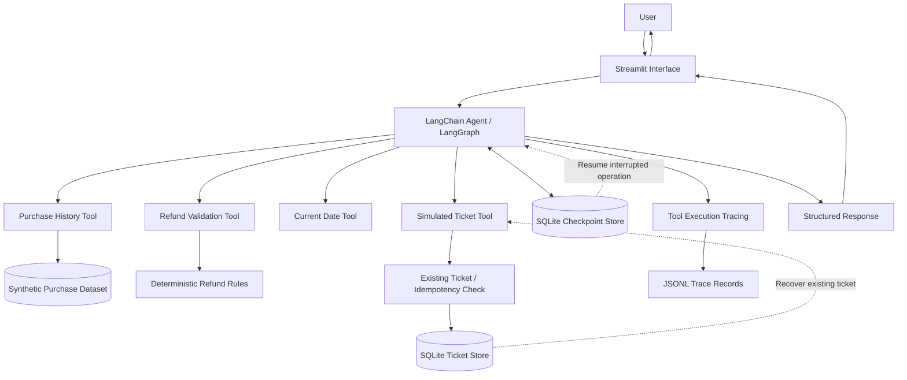

# AgentAudit

AgentAudit is an agentic refund-support application built with **LangChain, LangGraph, Groq, SQLite, and Streamlit**.

It demonstrates how an LLM-powered support agent can coordinate tools while relying on deterministic Python logic for refund eligibility, amount calculations, and ticket issuance.

> **Important:** Refund ticket issuance is simulated. This project does not initiate real payments, bank transfers, or refunds.

## Features

- Conversational refund-support interface built with Streamlit.
- LangChain agent orchestration backed by LangGraph.
- Groq-hosted Qwen model integration.
- Purchase-history lookup against a synthetic dataset of 1,000 users.
- Deterministic refund validation using a 30-day eligibility window.
- Decimal-based refund amount calculation.
- Simulated refund-ticket issuance with SQLite persistence.
- Request-ID-based idempotency to prevent duplicate tickets during retries.
- Persistent LangGraph checkpoints using SQLite.
- Interrupted-operation recovery for the active session using saved graph state.
- Cross-session conversation restoration is disabled in the unauthenticated shared UI.
- Tool execution tracing with JSONL records.
- DeepEval-based agent evaluation.

## Architecture



### Request and recovery lifecycle

1. The user submits a refund-support request through Streamlit.
2. The application invokes the LangGraph agent with a unique operation request ID.
3. The agent coordinates the available tools.
4. The ticket tool first checks whether the operation's request ID already has an issued ticket.
5. If a matching ticket exists, the original result is returned without revalidating current eligibility. This allows safe recovery after the original refund window expires.
6. If no ticket exists, deterministic Python validation checks purchase ownership, purchase dates, eligibility, and refund amounts.
7. If the new request is eligible, a simulated ticket is persisted transactionally in SQLite, with a second idempotency check in the write path.
8. LangGraph checkpoints preserve execution state so the active session can resume an interrupted operation through its retry flow.
9. On retry, the original request ID is reused so the existing-ticket lookup prevents duplicate ticket issuance.
10. The agent returns a structured response to the user.

The LLM handles conversation and tool coordination. Deterministic Python logic remains authoritative for refund eligibility and amount calculations.

The ticket database and checkpoint database have separate responsibilities:

- **Ticket store:** Persists simulated refund tickets and enforces request-level idempotency.
- **Checkpoint store:** Persists LangGraph execution state for interrupted-operation recovery.

## Technology Stack

| Component | Technology |
|---|---|
| Language | Python |
| Agent orchestration | LangChain / LangGraph |
| Model provider | Groq |
| Configured model | `qwen/qwen3.8-27b` |
| User interface | Streamlit |
| Structured validation | Pydantic |
| Persistence | SQLite |
| Checkpointing | LangGraph SQLite checkpointer |
| Evaluation | DeepEval |
| Tracing | Custom tool callbacks and JSONL records |
| Testing | pytest |

## Project Structure

```text
AgentAudit/
├── agent/
│   ├── .streamlit/
│   │   └── config.toml
│   ├── __init__.py
│   ├── agent.py
│   ├── agent_context.py
│   ├── checkpoint_store.py
│   ├── conversation_recovery.py
│   ├── data.py
│   ├── models.py
│   ├── objects.py
│   ├── prompts.py
│   ├── retry.py
│   ├── ticket_store.py
│   ├── tools.py
│   ├── tracing.py
│   ├── ui.py
│   └── users_data_1000.json
├── eval/
│   ├── agent_integration_benchmark.py
│   ├── benchmark_reporting.py
│   ├── dataset.py
│   ├── deterministic_benchmark.py
│   ├── eval_all.py
│   ├── evaluation_helpers.py
│   ├── EVALUATION_REPORT.md
│   ├── model.py
│   ├── results/
│   └── individual metric scripts
├── tests/
│   ├── test_agent_checkpoint_integration.py
│   ├── test_benchmark_reporting.py
│   ├── test_conversation_recovery.py
│   ├── test_evaluation_helpers.py
│   ├── test_issue_refund_ticket.py
│   ├── test_refund_rules.py
│   ├── test_retry_resume.py
│   └── test_ticket_store.py
├── understanding_metrics/
├── requirements.txt
└── .gitignore
```

## Getting Started

### 1. Clone the repository

```bash
git clone https://github.com/rj1230/agent_audit.git
cd agent_audit
```

### 2. Create a virtual environment

```bash
python -m venv .venv
```

Activate it on Windows PowerShell:

```powershell
.\.venv\Scripts\Activate.ps1
```

### 3. Install dependencies

```bash
python -m pip install -r requirements.txt
```

Alternatively, use `uv`:

```bash
uv pip install -r requirements.txt
```

### 4. Configure the API key

Create a `.env` file in the project root:

```env
GROQ_API_KEY=your_groq_api_key
```

Do not commit `.env` or expose API credentials.

### 5. Run the application

From the project root:

```bash
streamlit run agent/ui.py
```

Open the local Streamlit URL displayed in the terminal.

## Evaluation

Run the combined evaluation suite:

```bash
python -m eval.eval_all
```

The evaluation framework uses seven metrics:

1. Task Completion
2. Step Efficiency
3. Plan Quality
4. Plan Adherence
5. Argument Correctness
6. Tool Correctness
7. Answer Correctness

The evaluation uses a Groq-hosted judge model. Evaluation consumes additional API tokens and may be affected by provider rate limits.

## Tests

Run the automated test suite:

```bash
python -m pytest -q
```

The tests cover:

- Deterministic refund eligibility rules.
- Refund amount calculations.
- Ticket issuance and SQLite persistence.
- Idempotency and duplicate-ticket prevention.
- Retry request-ID validation.
- LangGraph checkpoint recovery.
- Conversation recovery module validation (the restore UI is disabled in shared deployments).
- Recovery after interruption following ticket persistence.

## Refund Rules

The deterministic refund validator:

- Requires a valid customer username.
- Requires at least one requested item.
- Rejects duplicate item requests.
- Checks that each requested item belongs to the customer.
- Rejects future-dated purchases.
- Enforces a 30-day refund window.
- Calculates eligible refund amounts using Python `Decimal` arithmetic.
- Rejects the request if any requested item fails validation.

For a new operation, the ticket tool validates eligibility before issuing a simulated ticket. For a retry, it first checks for an existing ticket and returns the original result when the request ID and identifying request details match.

## Persistence and Recovery

AgentAudit uses SQLite for two independent persistence workflows.

**Refund ticket persistence**

- Stores issued simulated refund tickets.
- Uses a unique request ID to identify an operation.
- Checks for an existing ticket before revalidating a retry.
- Uses a transactional write path to prevent duplicate ticket creation.
- Rejects reuse of an idempotency key with a conflicting payload.

**Conversation checkpoint persistence**

- Stores LangGraph execution checkpoints in SQLite.
- Preserves the original request ID across retries.
- Supports resuming interrupted graph execution through the active session's retry flow.
- The unauthenticated shared UI does not expose cross-session conversation listing or restoration; both remain disabled until authenticated ownership checks are implemented.

The recovery design is intended to prevent duplicate simulated ticket issuance when execution is interrupted after the ticket has already been persisted.

## Tracing

Tool execution traces are written as JSONL records under:

```text
agent/traces/
```

These records support inspection of:

- Tool execution arguments and results.
- Execution status.
- Tool latency.
- Agent behavior across operations.

Trace files may contain customer and conversation data. Treat them as sensitive runtime data and do not commit them.

## Limitations and Security Considerations

- Refund tickets are simulated and are not connected to a payment provider.
- Customer and purchase records are synthetic demonstration data.
- Production customer authentication and authorization are not implemented.
- SQLite persistence does not provide a complete multi-process deployment or distributed coordination solution.
- Recovery depends on the checkpoint database and original operation request ID being available.
- Trace and checkpoint data require appropriate access controls and retention policies before production use.
- Evaluation results depend on the configured judge model and provider availability.

## Project Purpose

AgentAudit explores the engineering of tool-using support agents, with emphasis on:

- Deterministic business-rule enforcement.
- Structured agent responses.
- Tool orchestration and execution tracing.
- Persistent execution state.
- Idempotent operations and retry recovery.
- Automated agent evaluation.

It is a demonstration project, not a production refund-processing system.
