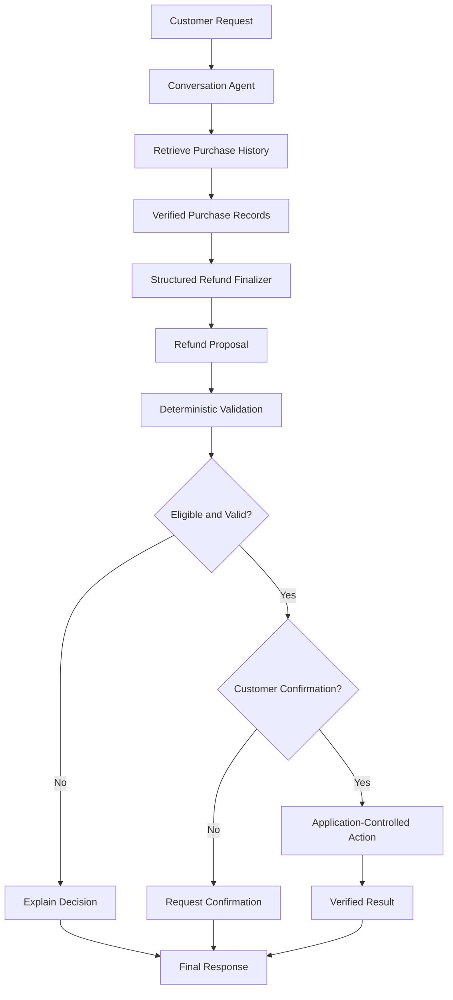

<div align="center">

# 🧠 AgentAudit

### Auditable AI Refund Support Agent

**An evaluation-driven AI agent that handles refund requests with verified data, deterministic business rules, explicit confirmation, tool tracing, and persistent evaluation.**

[](https://www.python.org/)
[](https://www.langchain.com/)
[](https://github.com/langchain-ai/langgraph)
[](https://groq.com/)
[](https://deepeval.com/)
[](https://streamlit.io/)
[](https://www.sqlite.org/)

🔗 **Repository:** [AgentAudit](https://github.com/rj1230/AgentAudit)

</div>

---

## 📌 Overview

**AgentAudit** is a production-oriented AI agent for customer refund support. It is designed to make refund decisions verifiable, traceable, and controlled by application-level business logic rather than relying on unrestricted language-model output.

Instead of allowing an LLM to directly execute refunds, AgentAudit follows a structured workflow: it understands the customer request, retrieves verified purchase history, creates a structured refund proposal, validates the proposal against deterministic rules, requires confirmation where needed, and only then executes the approved action.

The project is built around one core principle:

> **The model can propose an action, but application code owns validation and execution.**

---

## ✨ Key Capabilities

### 🤖 Two-Stage Agent Workflow

- **Conversation agent** understands customer requests and manages the dialogue.
- **Structured refund finalizer** converts the conversation into a machine-readable refund proposal.
- **Separation of concerns** ensures that language-model reasoning does not directly control consequential business operations.
- **Persistent conversation state** preserves context across multiple interactions.

### 🔍 Verified Decisioning

- **Purchase-history retrieval** obtains authoritative purchase records before a refund is considered.
- **Structured proposals** represent the requested items, refund amount, and decision rationale in a predictable format.
- **Deterministic validation** checks eligibility, item ownership, purchase dates, and refund amounts in application code.
- **No unsupported execution claims:** the agent cannot state that a refund or ticket was completed without a verified execution result.

### 🛡️ Controlled Execution

- **Explicit confirmation control** prevents consequential actions from proceeding without required customer approval.
- **Application-controlled action path** executes only validated and approved refund operations.
- **Verified result handling** ensures the customer receives a response based on the actual execution outcome.
- **Fail-safe design** prevents the model from bypassing business rules or confirmation requirements.

### 📈 Evaluation & Reliability

- **Seven-metric evaluation framework** covering both trace-level and single-turn behavior.
- **Trace-based evaluation** assesses task completion, step efficiency, plan quality, and plan adherence.
- **Single-turn evaluation** assesses deterministic argument correctness, tool correctness, and answer correctness.
- **Persistent evaluation storage** records runs, case results, metric statuses, and trace artifacts in SQLite.
- **Resume support** avoids rerunning completed evaluations unnecessarily.

### 📡 Observability

- **Tool-call tracing** captures executed tool calls and agent execution paths.
- **Trace artifacts** are stored for inspection and later evaluation.
- **Failure classification** distinguishes agent failures from infrastructure errors, skipped metrics, and quota-blocked evaluations.
- **SQLite-backed evaluation history** enables reproducible analysis across runs.

---

## 🏗️ Architecture



### Refund Flow

1. **Customer request** is received through the Streamlit interface.
2. **Conversation agent** interprets the request and manages the dialogue.
3. **Purchase-history tool** retrieves verified purchase records.
4. **Structured finalizer** produces a refund proposal.
5. **Deterministic validator** checks the proposal against verified data and business rules.
6. **Confirmation control** determines whether customer approval is required.
7. **Application-controlled execution** runs only approved and validated actions.
8. **Verified result** is returned to the customer.

---

## 🧩 Tech Stack

| Layer | Tools |
|---|---|
| Language | Python |
| Agent framework | LangChain |
| Agent orchestration | LangGraph |
| LLM provider | Groq |
| Agent model | `openai/gpt-oss-20b` |
| Structured output | Pydantic / structured model output |
| Conversation persistence | LangGraph checkpointing |
| Evaluation | DeepEval |
| Evaluation storage | SQLite |
| Observability | Agent execution traces |
| User interface | Streamlit |
| Testing | pytest |

---

## 📂 Project Structure

```text
AgentAudit/
│
├── agent/
│   ├── agent.py
│   ├── two_stage.py
│   └── ...
│
├── eval/
│   ├── eval_all.py
│   ├── eval_persistent.py
│   ├── evaluation_helpers.py
│   ├── result_store.py
│   └── ...
│
├── data/
│   └── users_data_1000.json
│
├── traces/
│   └── agent_traces.jsonl
│
├── tests/
│
├── ui.py
├── requirements.txt
├── .env.example
└── README.md
```

> **Note:** The project structure is a high-level illustration. Update it to match the final repository layout.

---

## 🚀 Quick Start

### 1. Clone the repository

```bash
git clone [https://github.com/rj1230/AgentAudit.git](https://github.com/rj1230/AgentAudit.git)
cd AgentAudit
```

### 2. Create a virtual environment

```powershell
py -3.13 -m venv .venv
.\.venv\Scripts\Activate.ps1
```

### 3. Install dependencies

```bash
python -m pip install --upgrade pip
pip install -r requirements.txt
```

### 4. Configure environment variables

Create a `.env` file in the project root:

```env
GROQ_API_KEY=your_groq_api_key
```

> ⚠️ Never commit `.env` files or API keys to GitHub.

### 5. Run the application

```bash
streamlit run ui.py
```

---

## 🧪 Running Evaluations

Run the persistent evaluation pipeline:

```bash
python -m eval.eval_persistent
```

Evaluate an individual case:

```bash
python -m eval.eval_persistent --case-number 1
```

Resume an existing evaluation:

```bash
python -m eval.eval_persistent --resume --run-id "YOUR_RUN_ID"
```

The default SQLite evaluation database is:

```text
eval/results/agent_audit.sqlite3
```

The persistent evaluation system preserves completed work and avoids rerunning already evaluated cases unnecessarily.

---

## 🧪 Testing

Run the full test suite:

```bash
python -m pytest -q
```

Run a focused test module:

```bash
python -m pytest tests/test_two_stage.py -q
```

> Adjust the focused test path to match the actual test files in the repository.

---

## 📊 Evaluation Framework

AgentAudit evaluates both the quality of agent behavior and the correctness of its tool usage.

### Trace-Based Metrics

| Metric | Purpose |
|---|---|
| Task Completion | Measures whether the agent completes the requested task |
| Step Efficiency | Measures whether the agent avoids unnecessary steps |
| Project Plan Quality | Measures the quality of the agent’s execution plan |
| Project Plan Adherence | Measures whether the agent follows its intended plan |

### Single-Turn Metrics

| Metric | Purpose |
|---|---|
| Deterministic Argument Correctness | Checks whether tool arguments match verified data and rules |
| Tool Correctness | Checks whether the correct tools are used in the correct order |
| Answer Correctness | Checks whether the final response is accurate and appropriate |

### Evaluation Capabilities

- Persistent run and case tracking.
- Per-metric result storage.
- Reuse of previously captured traces.
- Resume support for interrupted evaluation runs.
- Independent metric evaluation.
- Explicit status classification for failed, skipped, and unevaluated metrics.
- Quota-aware handling of external judge failures.
- Avoidance of unnecessary agent reinvocation when saved results can be reused.

The objective is to distinguish genuine agent-quality problems from infrastructure failures and evaluator-provider limitations.

---

## 🛡️ Safety Model

AgentAudit uses a defense-in-depth approach:

- **Verified data access:** Refund decisions are based on retrieved purchase records, not model assumptions.
- **Structured proposals:** Refund decisions are represented in a predictable, machine-readable format.
- **Deterministic validation:** Business rules are enforced in application code.
- **Explicit confirmation:** Consequential actions require required customer approval.
- **Controlled execution:** Only validated and approved actions can be executed.
- **Verified responses:** The agent cannot claim completion without a verified execution result.

---

## 🧭 Engineering Goals

- Separate probabilistic reasoning from deterministic execution.
- Use structured interfaces between agent stages.
- Validate against authoritative application data.
- Require explicit control over consequential actions.
- Maintain persistent, recoverable workflows.
- Capture trace-level observability.
- Support reproducible and resumable evaluation.
- Clearly classify application failures and evaluator failures.

---

## 📈 Current Development Status

| Area | Status |
|---|---|
| Two-stage agent workflow | Implemented; under validation |
| Purchase-history retrieval | Implemented |
| Structured refund finalization | Implemented; under validation |
| Deterministic refund validation | Implemented; under validation |
| Persistent conversation state | Implemented |
| Trace capture | Implemented; under validation |
| Seven-metric evaluation | Evaluation pipeline under active validation |
| Persistent evaluation storage | Implemented |
| Resume and trace reuse | Implemented; under validation |
| Streamlit interface | Implemented; iterative development |

---

## 🔮 Future Improvements

- Complete evaluation validation across the full dataset.
- Expand edge-case and adversarial test coverage.
- Improve trace inspection and evaluation reporting.
- Add latency and token-cost measurements.
- Establish regression thresholds for agent behavior.
- Add automated evaluation reports for reproducible comparisons.
- Strengthen deployment and operational monitoring.

---

## 💡 Why This Project?

AgentAudit explores a central challenge in agent engineering:

> How do we make an AI agent useful without allowing its generated output to become an unchecked business action?

Rather than treating an agent response as proof of successful execution, AgentAudit separates proposal generation, deterministic validation, confirmation, execution, and verification.

The goal is to build an agent that is not only capable of completing a task, but whose behavior can also be inspected, evaluated, and tested.

---

## 👤 Author

**Raj Rajput**  
GitHub: [@rj1230](https://github.com/rj1230)

Built as an AI engineering portfolio project focused on reliable agent workflows, evaluation, observability, and deterministic control.
