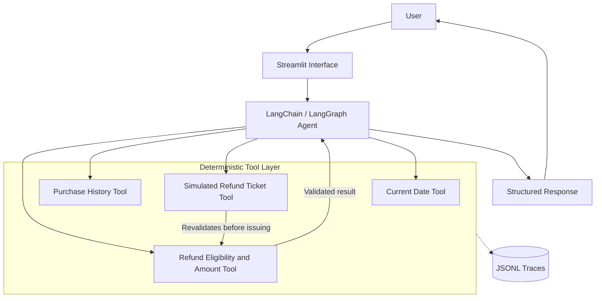

<div align="center">

# 🧾 AgentAudit

### Tool-Using Refund-Support Agent with Deterministic Business Logic

**An LLM agent that coordinates tools while Python stays authoritative for refund eligibility and amounts, with full tool-level tracing and a seven-metric evaluation suite.**

[](https://www.python.org/)
[](https://www.langchain.com/)
[](https://github.com/langchain-ai/langgraph)
[](https://groq.com/)
[](https://streamlit.io/)
[](https://github.com/confident-ai/deepeval)

</div>

---

## 📌 Overview

**AgentAudit** is an agentic refund-support application built with LangChain, LangGraph, Groq, and Streamlit.

Instead of letting the model decide refund outcomes, AgentAudit splits responsibilities: the LLM handles conversation and tool coordination, while deterministic Python logic validates purchases, enforces the refund window, and calculates amounts.

The project is built around one core principle:

> **The LLM coordinates. Python decides.** Eligibility and money are never left to model judgment.

> ⚠️ **Important:** Refund ticket issuance is simulated. This project does not initiate real payments, bank transfers, or refunds.

---

## ✨ Key Capabilities

### 🤖 Agentic Support Workflow

- **Conversational refund interface** built with Streamlit.
- **LangChain agent orchestration** backed by LangGraph.
- **Groq-hosted Qwen model** for tool selection and response generation.
- **Structured responses** validated with Pydantic.

### 🧮 Deterministic Refund Logic

- **Purchase-history lookup** against a synthetic dataset of 1,000 users.
- **30-day eligibility window** enforced in Python, not in the prompt.
- **Decimal-based amount calculation** to avoid floating-point money errors.
- **Revalidation at ticket time:** the ticket tool re-checks eligibility before issuing a simulated result.

### 🔍 Traceability

- **Tool execution tracing** via custom callbacks.
- **JSONL trace records** capturing tool calls, latency, and results.
- **Inspectable agent behavior** for debugging and auditing.

### 📈 Evaluation

- **DeepEval-based agent evaluation** across seven metrics.
- **Combined evaluation runner** for end-to-end scoring.
- **Groq-hosted judge model** for metric scoring.

---

## 🏗️ Architecture



### Request Flow

1. **User** describes a refund request in the Streamlit chat.
2. **Agent** resolves the current date and looks up the customer's purchase history.
3. **Eligibility tool** validates each requested item and calculates the refund amount with `Decimal` arithmetic.
4. **Ticket tool** revalidates eligibility, then returns a simulated refund ticket.
5. **Tracing callbacks** write each tool execution to a JSONL record.
6. **Agent** returns a structured response to the user.

---

## 📏 Refund Rules

The refund validator is the source of truth for every outcome. It:

- Requires a valid customer username.
- Requires at least one requested item.
- Rejects duplicate item requests.
- Checks that each requested item belongs to the customer.
- Rejects future-dated purchases.
- Enforces a 30-day refund window.
- Calculates the eligible amount using Python `Decimal` arithmetic.
- **Rejects the entire request if any requested item fails validation.**

---

## 🧩 Tech Stack

| Layer | Tools |
|---|---|
| Language | Python |
| Agent orchestration | LangChain, LangGraph |
| Model provider | Groq |
| Configured model | `qwen/qwen3.8-27b` |
| User interface | Streamlit |
| Structured validation | Pydantic |
| Evaluation | DeepEval |
| Tracing | Custom tool callbacks, JSONL records |

---

## 📂 Project Structure

```text
AgentAudit/
├── agent/
│   ├── .streamlit/
│   │   └── config.toml       # Streamlit theme and settings
│   ├── agent.py              # LangChain / LangGraph agent setup
│   ├── data.py               # Dataset loading and lookups
│   ├── models.py             # Pydantic schemas
│   ├── objects.py            # Shared objects
│   ├── prompts.py            # System prompt and instructions
│   ├── tools.py              # Agent tools and refund logic
│   ├── tracing.py            # Tool callbacks and JSONL trace writer
│   ├── ui.py                 # Streamlit entrypoint
│   └── users_data_1000.json  # Synthetic customer and purchase data
├── eval/
│   ├── dataset.py            # Evaluation test cases
│   ├── eval_all.py           # Combined seven-metric runner
│   ├── model.py              # Groq-hosted judge model wrapper
│   └── ...                   # Individual metric scripts
├── understanding_metrics/    # Notes and experiments on each metric
├── requirements.txt
└── .gitignore
```

---

## 🚀 Quick Start

### 1. Clone and enter the project

```bash
git clone https://github.com/rj1230/agent_audit.git
cd agent_audit
```

### 2. Create a virtual environment

```bash
python -m venv .venv
```

Activate it:

```powershell
# Windows PowerShell
.\.venv\Scripts\Activate.ps1
```

```bash
# macOS / Linux
source .venv/bin/activate
```

### 3. Install dependencies

```bash
python -m pip install -r requirements.txt
```

Or with `uv`:

```bash
uv pip install -r requirements.txt
```

### 4. Configure environment variables

Create a `.env` file in the project root:

```env
GROQ_API_KEY=your_groq_api_key
```

> Never commit `.env` or expose API credentials.

### 5. Launch the Streamlit UI

From the project root:

```bash
streamlit run agent/ui.py
```

Open the local URL shown in the terminal.

### 6. Run the evaluation suite

```bash
python -m eval.eval_all
```

---

## 🧪 Evaluation

AgentAudit evaluates complete agent executions across seven DeepEval metrics:

| # | Metric | What it checks |
|---|---|---|
| 1 | **Task Completion** | Whether the agent accomplished the user's refund request |
| 2 | **Step Efficiency** | Whether the agent reached the outcome without redundant steps |
| 3 | **Plan Quality** | Whether the agent's plan was logical and complete |
| 4 | **Plan Adherence** | Whether the agent followed its own plan |
| 5 | **Argument Correctness** | Whether tool calls were made with correct arguments |
| 6 | **Tool Correctness** | Whether the right tools were called |
| 7 | **Answer Correctness** | Whether the final answer matches the expected outcome |

> Evaluation uses a Groq-hosted judge model, consumes additional API tokens, and may be affected by provider rate limits. Scores depend on the configured judge model.

---

## 📡 Tracing

Tool execution traces are written as JSONL records under:

```text
agent/traces/
```

Each record supports inspection of tool execution, latency, results, and overall agent behavior.

> 🔒 Trace files may contain customer and conversation data. Treat them as sensitive runtime data and do not commit them.

---

## 🛡️ Design Model

AgentAudit separates concerns so that the riskiest decisions never rest on the LLM:

- **Deterministic eligibility:** Window, ownership, and duplicate checks live in Python.
- **Decimal arithmetic:** Refund amounts avoid floating-point drift.
- **All-or-nothing validation:** One invalid item rejects the whole request.
- **Revalidation at issuance:** The ticket tool never trusts earlier tool output.
- **Simulated side effects:** No real payment system is connected.
- **Traceable execution:** Every tool call is logged for later review.

---

## ⚠️ Limitations

- Refund tickets are simulated and not connected to a payment provider.
- Customer and purchase records are synthetic demonstration data.
- No production customer authentication is implemented.
- The in-memory conversation checkpointer does not provide durable persistence.
- Evaluation results depend on the judge model and provider availability.

---

## 🎯 Project Purpose

AgentAudit explores the engineering of tool-using support agents, with emphasis on deterministic business rules, structured responses, tool execution, traceability, and evaluation.

It is a demonstration project, not a production refund-processing system.
